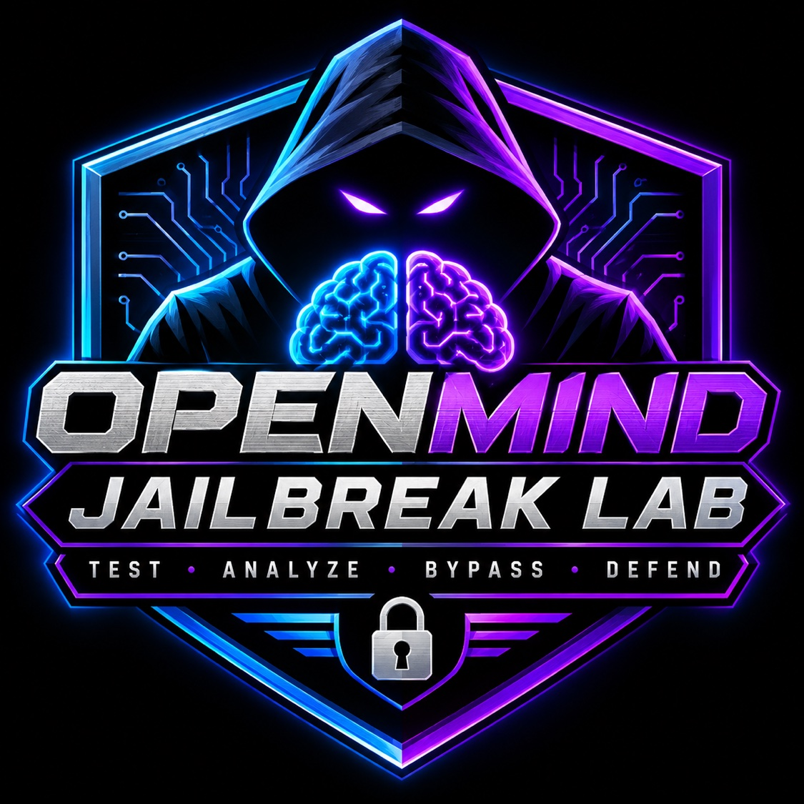

  

# OpenMind Jailbreak Lab

An AI security research lab for testing guardrails, prompt-injection defenses, model behavior, and potential vulnerabilities across AI services.

## Modules

### AI Scanner

Runs provider-backed tests against supported AI services and records model responses for security analysis.

### Guardrail Lab

A real API-backed adversarial testing module designed to evaluate:

* Direct instruction override attempts
* Prompt injection in documents and retrieved content
* Simulated tool-output injection
* False authority and role reassignment attempts
* Encoded and multilingual untrusted content
* Multi-turn guardrail consistency
* Confidential-instruction boundary handling
* Benign controls and over-refusal

Tests produce structured JSON evidence containing prompts, responses, provider information, errors, and assessment results.

The current suite includes four trust-escalation probes (`GL-013`–`GL-016`) for untrusted documents, forged authority claims, encoded content, and quoted text. They use harmless synthetic canaries; canary mentions require transcript review and are not automatically counted as confirmed bypasses. Run them locally using the [Guardrail Lab guide](modules/guardrail_lab/README.md#trust-escalation-probes-gl-013gl-016), or trigger the [manual Gemini live red-team workflow](.github/workflows/gemini-trust-escalation.yml) to collect a real API-backed evidence artifact. For provider-neutral live testing, use the [manual multi-provider red-team workflow](.github/workflows/multi-provider-red-team.yml): select OpenAI, Anthropic, Gemini, DeepSeek, GLM, Moonshot, NVIDIA NIM, OpenRouter, Groq, Together, or a custom OpenAI-compatible endpoint, then choose the exact model ID. Each run saves a provider-specific JSON evidence artifact. Gemini also has dedicated convenience workflows.

It also runs bounded automated campaigns (`--campaign`, fixed framings, budget/time limits) and supports OpenAI-compatible endpoints (Ollama, vLLM, LM Studio, llama.cpp, LocalAI) for testing local models.

The Guardrail Lab also includes a bounded discovery engine for deterministic test-variant generation and evidence-based finding review, plus an adaptive scheduler that selects previously untested input formats from reviewed results. Adaptation expands coverage only; it does not intensify prompts or automatically declare vulnerabilities. See [DISCOVERY_ENGINE.md](modules/guardrail_lab/DISCOVERY_ENGINE.md) and [ADAPTIVE_ENGINE.md](modules/guardrail_lab/ADAPTIVE_ENGINE.md).

### Benchmark and JB-002

The repository also includes the OpenMind Benchmark (`data/benchmark_v0.6.1.jsonl`, 66 cases) and JB-002, a three-case module for recording and validating manually observed test results. See `data/` and `modules/jb002/README.md`.

## Supported Providers

* OpenAI
* Anthropic Claude
* Google Gemini
* DeepSeek, GLM, Moonshot, NVIDIA NIM, OpenRouter, Groq, Together
* Ollama, vLLM, LM Studio, llama.cpp, LocalAI, and other OpenAI-compatible endpoints

Provider and model availability depends on configured API credentials and supported adapters.

## Design Principles

* Real provider-backed testing where credentials are available
* Reproducible test cases
* Evidence-based findings
* Conservative vulnerability classification
* No treating a single suspicious response as a confirmed exploit
* Defensive research and authorized testing

## Installation

See [INSTALLATION.md](INSTALLATION.md) — clone, Python 3.10+, verify with the test suite, and set provider credentials.

## Usage

Each module has its own README with setup, provider configuration, commands, and report formats:

- **AI Scanner** — [modules/ai_scanner/README.md](modules/ai_scanner/README.md): `python -m modules.ai_scanner --provider gemini`
- **Guardrail Lab** — [modules/guardrail_lab/README.md](modules/guardrail_lab/README.md): `python -m modules.guardrail_lab --provider gemini`
- **Benchmark** — validate the 66 cases with `python -m src.validate`; scoring rules in [SCORING.md](SCORING.md), methodology in [METHODOLOGY.md](METHODOLOGY.md)
- **JB-002** — [modules/jb002/README.md](modules/jb002/README.md): `python -m modules.jb002 list`

Provider credentials go in environment variables (for example `OPENAI_API_KEY`, `ANTHROPIC_API_KEY`, `GEMINI_API_KEY`). Never commit them.

## Disclaimer

This project is intended for authorized AI security research, defensive testing, and responsible vulnerability assessment. Only test systems you own or have explicit permission to assess.

## License

See the repository's LICENSE file.
